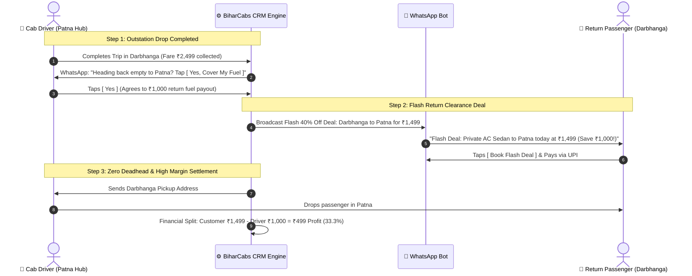
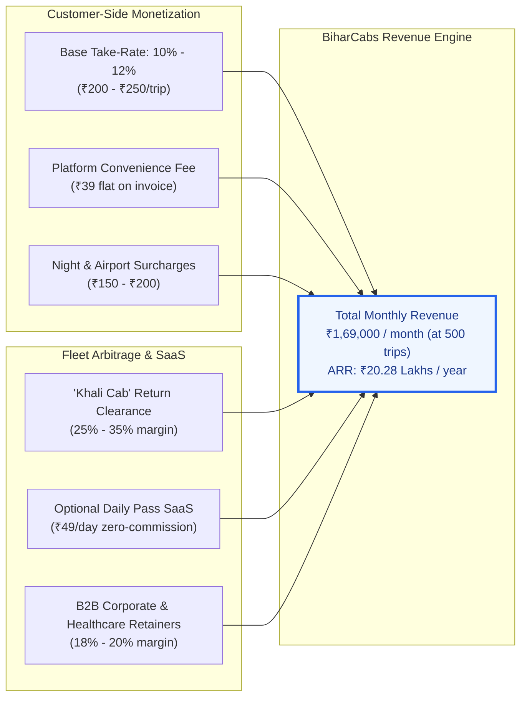
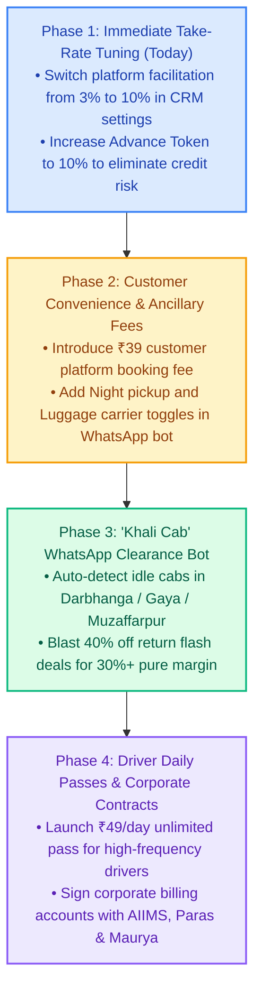

# How BiharCabs.com Can Earn Significantly More: Monetization & Revenue Expansion Blueprint

---

## Executive Summary: The "3% Commission Trap" & Real Unit Economics

In low-ticket or regional mobility operations, setting the platform facilitation fee to **3%** leads to severe unit-economic failure. 

### Why 3% Loses Money on Every Trip

Consider a standard one-way intercity trip from **Patna to Darbhanga** (Fare: **₹2,000**):

| Cost / Revenue Line Item | Amount (₹) | Accounting Impact |
| :--- | :--- | :--- |
| **Gross Trip Fare** | ₹2,000.00 | Paid by Customer |
| **3% Platform Facilitation Fee** ($X$) | ₹60.00 | BiharCabs Revenue |
| **Tech Software Dispatch Fee** | ₹10.00 | BiharCabs Revenue |
| **Statutory 18% GST on Facilitation** | -₹10.80 | Payable to Govt (CGST Sec 9(5)) |
| **Meta WhatsApp Cloud API Costs** | -₹6.00 | Template + utility messages |
| **Payment Gateway MDR (1.5%–2%)** | -₹4.00 | On advance token collection |
| **Net Gross Revenue Remaining** | **₹49.20** | BiharCabs Operating Margin |
| **Customer Acquisition Cost (CAC)** | **-₹180.00** | Google Search / Meta Ads in Bihar |
| **Net Economic Loss per Booking** | **-₹130.80** | **Loss on Every 3% Ride** |

> **Key Takeaway:** At a 3% take-rate, BiharCabs loses between **₹100 to ₹180 on every booking** once customer acquisition and conversational infrastructure costs are accounted for.

```mermaid
flowchart TD
    subgraph S1["3% Take-Rate (Current Trap)"]
        C1["Customer Pays: ₹2,000"] --> B1["Gross Fee (3% + ₹10): ₹70"]
        B1 --> D1["Less 18% GST: -₹10.80"]
        D1 --> D2["Less WhatsApp & Gateway: -₹10.00"]
        D2 --> D3["Net Before CAC: +₹49.20"]
        D3 --> D4["Customer Acquisition CAC: -₹180.00"]
        D4 --> LOSS["NET PROFIT: -₹130.80 (LOSS)"]
        style LOSS fill:#fee2e2,stroke:#ef4444,stroke-width:2px,color:#991b1b
    end

    subgraph S2["10% Take-Rate + Convenience Fee (Recommended)"]
        C2["Customer Pays: ₹2,000 + ₹39 fee"] --> B2["Gross Fee (10% + ₹10 + ₹39): ₹249"]
        B2 --> E1["Less 18% GST: -₹36.00"]
        E1 --> E2["Less WhatsApp & Gateway: -₹10.00"]
        E2 --> E3["Net Before CAC: +₹203.00"]
        E3 --> E4["Customer Acquisition CAC: -₹180.00 (Trip 1)"]
        E4 --> PROFIT1["NET PROFIT (Trip 1): +₹23.00"]
        E3 --> PROFIT2["NET PROFIT (Repeat Trips): +₹203.00"]
        style PROFIT1 fill:#dcfce7,stroke:#22c55e,stroke-width:2px,color:#166534
        style PROFIT2 fill:#dcfce7,stroke:#16a34a,stroke-width:3px,color:#14532d
    end
```

---

## 6 Proven Levers to Maximize BiharCabs' Revenue

---

### Lever 1: Align Platform Commission with Intercity Industry Standard (10% – 12%)

#### Benchmark Comparison:
* **Ola / Uber:** 20% – 28% *(Generates high driver churn, driver resistance, and off-app cash negotiations)*.
* **MakeMyTrip / Savaari Outstation:** 15% – 20%.
* **Traditional Offline Travel Desks in Patna:** 10% – 15%.
* **BiharCabs Recommended Sweet Spot:** **10% – 12%**.

#### Why Bihar Drivers Readily Accept 10%:
1. Traditional taxi stands (Patna Junction, Airport, Gandhi Maidan) charge drivers ₹100–₹200 gate fees or union cuts for unverified walk-in leads.
2. An online guaranteed booking with advance token protection saves the driver 3–5 hours of idle waiting.
3. Drivers are delighted to give 10% because **90% is guaranteed take-home income**.

#### Financial Impact:
* On a ₹2,000 ride at **10%**:
  * Platform Commission: **₹200.00**
  * Flat Tech Fee: **₹10.00**
  * GST (18% on ₹200): ₹36.00 (collected on top or within fee)
  * Net BiharCabs Margin: **₹180.00+** per ride (**+270% increase** over 3%).

---

### Lever 2: Fixed Spread / Margin Model (Route-by-Route Arbitrage)

Instead of a percentage, BiharCabs sets a **Market Customer Price** and contracts drivers at their **Floor Operating Cost per KM**.

#### Example: Patna &rarr; Muzaffarpur (75 km one-way)
* **Market Customer Fare (Sedan):** **₹1,699**
* **Driver Floor Cost:** ₹1,350 (₹18.00/km covers fuel + driver wage)
* **BiharCabs Fixed Margin:** **₹349.00 (20.5% Gross Margin)**

#### Example: Patna &rarr; Darbhanga (145 km one-way)
* **Market Customer Fare (Sedan):** **₹2,499**
* **Driver Floor Cost:** ₹2,100 (₹14.50/km)
* **BiharCabs Fixed Margin:** **₹399.00 (16.0% Gross Margin)**

*Note: The BiharCabs CRM engine already natively supports this via the `FIXED_MARGIN` configuration in `crm_settings`.*

---

### Lever 3: Empty Return Cab ("Khali Cab") Clearance Arbitrage (25% – 35% Margin)

In Bihar, one of the biggest inefficiencies is the **Deadhead Empty Run**:
* Over **65% of cabs** that drop passengers from Patna to Darbhanga, Gaya, Purnia, or Bhagalpur return completely empty.
* The driver makes **₹0.00** on the return leg and wastes diesel.

#### The BiharCabs Empty Return Clearance Engine:
1. When a driver completes a drop in Darbhanga, the CRM flags their cab as `AVAILABLE_FOR_RETURN` to Patna for the next 4 hours.
2. The WhatsApp Bot broadcasts a **"Flash 40% Off Return Deal"** to customers in Darbhanga:
   * Normal Fare: ₹2,499
   * Flash Return Fare: **₹1,499** (cheaper than luxury bus tickets for 2–3 people).
3. **Driver Payout:** **₹1,000** (covers their return fuel + pocket money for a trip they would have driven empty anyway).
4. **BiharCabs Keeps:** **₹499 (33.3% Pure Margin)** on a ride that previously generated zero revenue.

---

### Lever 4: Customer Ancillary & Convenience Fees

Aggregators worldwide generate high-margin profitability through ancillary charges that customers gladly pay for reliability:

| Ancillary Fee Type | Amount | When Triggered | Customer Perception |
| :--- | :--- | :--- | :--- |
| **Platform Convenience Fee** | ₹29 – ₹49 | Every single booking | Standard fee across BookMyShow, IRCTC, Rapido |
| **Night / Early Morning Surcharge** | ₹150 – ₹250 | Pickups between 10:00 PM – 06:00 AM | Split 50/50 with driver for night incentive |
| **Patna Airport Toll & Parking Pass** | ₹100 | Airport pickups/drops | Pre-bundled convenience; avoids cash arguments |
| **Luggage Roof Carrier Surcharge** | ₹150 | Bookings with 3+ large bags / wedding gear | Dedicated commercial luggage rack provided |
| **Express Highway Route Guarantee** | ₹100 – ₹150 | JP Ganga Path (Marine Drive) / Atal Path routing | Guaranteed faster transit time |

*If BiharCabs charges a modest **₹39 convenience fee** on 1,000 monthly bookings, that generates **₹39,000/month in 100% pure profit** with zero additional operational cost.*

---

### Lever 5: Driver Daily Pass Subscription (The "Zero-Commission SaaS" Model)

Drivers in Bihar often experience psychological pain when 10%–15% is deducted from every cash payment they collect from passengers.

#### The Namma Yatri / Daily Pass Alternative:
* **The Proposition:** *"Pay ₹49 in the morning, get unlimited ride alerts all day with 0% commission on your trips."*
* **Monthly Fleet Pass:** **₹1,199 / month** for dedicated full-time fleet partners.

#### Unit Economics of the Subscription Model:
* 150 active drivers &times; ₹49/day &times; 30 days = **₹2,20,500 / month**
* 50 premium drivers &times; ₹1,199/month pass = **₹59,950 / month**
* **Total Predictable Monthly Software ARR:** **~₹33.6 Lakhs / year**
* **Operational Benefit:** Eliminates cash recovery disputes entirely; revenue is collected upfront every single morning.

---

### Lever 6: High-Margin B2B Corporate, Hospital & Hotel Contracts

Patna and regional centers in Bihar have significant corporate and institutional mobility demand:

1. **Healthcare Travel Hubs:**
   * AIIMS Patna, Paras HMRI Hospital, Medanta Patna, Ruban Memorial Hospital.
   * Patients and families travel from Nepal border, Mithilanchal, and eastern UP for treatments and require sanitized, reliable cabs.
2. **Corporate & Government Projects:**
   * Infrastructure, banking, telecom, and solar energy site inspection teams traveling across district headquarters.
3. **Luxury Hotel Front Desks:**
   * Hotel Maurya, Lemon Tree Premier, Hotel Panache.
   * Offer concierge desk booking with a **15% – 20% margin** billed on 15-day corporate credit.

---

## Financial Projections: 3% vs. Recommended Model

### Based on 500 Completed Rides / Month (Average Ticket: ₹2,200)

| Revenue Metric | Current 3% Take-Rate | Recommended Model (10% + Fees + Clearance) |
| :--- | :--- | :--- |
| **Monthly Gross Booking Value (GBV)** | ₹11,00,000 | ₹11,00,000 |
| **Base Facilitation Commission** | ₹33,000 (3%) | ₹1,10,000 (10%) |
| **Tech / Software Fees** | ₹5,000 (₹10/trip) | ₹5,000 (₹10/trip) |
| **Customer Convenience Fees (₹39/trip)** | ₹0 | ₹19,500 |
| **Empty Return Clearance Arbitrage (50 trips)** | ₹0 | ₹22,500 (₹450/trip margin) |
| **Night & Luggage Surcharges** | ₹0 | ₹12,000 |
| **Total Gross Revenue** | **₹38,000 / month** | **₹1,69,000 / month** |
| **Annualized Recurring Revenue (ARR)** | **₹4.56 Lakhs / yr** | **₹20.28 Lakhs / yr** |
| **Net Multiple Expansion** | *Baseline* | **4.45x Revenue Increase** |

---

## Action Plan & Recommended Rollout

### Phase 1: Immediate Settings Update (Zero Code Change)
1. Open the BiharCabs CRM **Dynamic System Settings** (`/settings`).
2. Update `platform_facilitation_percentage` from `3.0` &rarr; `10.0`.
3. Set the Universal Advance Booking Token to `10.0%` (covers the entire company fee $Z$ before trip start).

### Phase 2: Add Customer Platform Convenience Fee
1. Add a flat **₹39 Platform Convenience Fee** to the dynamic quote generator (`/api/pricing/quote`).
2. Include the itemized fee transparently on customer invoice PDFs and WhatsApp price cards.

### Phase 3: Launch "Khali Cab" WhatsApp Clearance
1. Trigger an automated WhatsApp prompt to drivers completing outstation trips: *"Are you heading back to Patna? Tap [ Yes, Find Me Return Passenger ] to cover your fuel."*
2. Broadcast discounted return deals to WhatsApp customer inquiries for reverse routes.

---

*Document generated and saved in BiharCabs CRM Design Repository: `crm-design/HOW_BIHARCABS_CAN_EARN_MORE.md`.*

