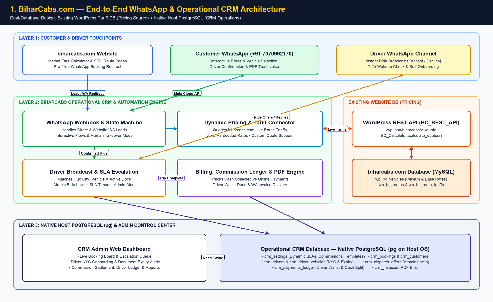
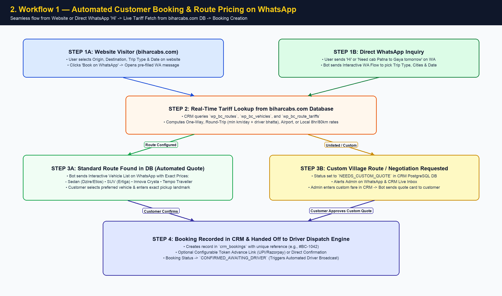
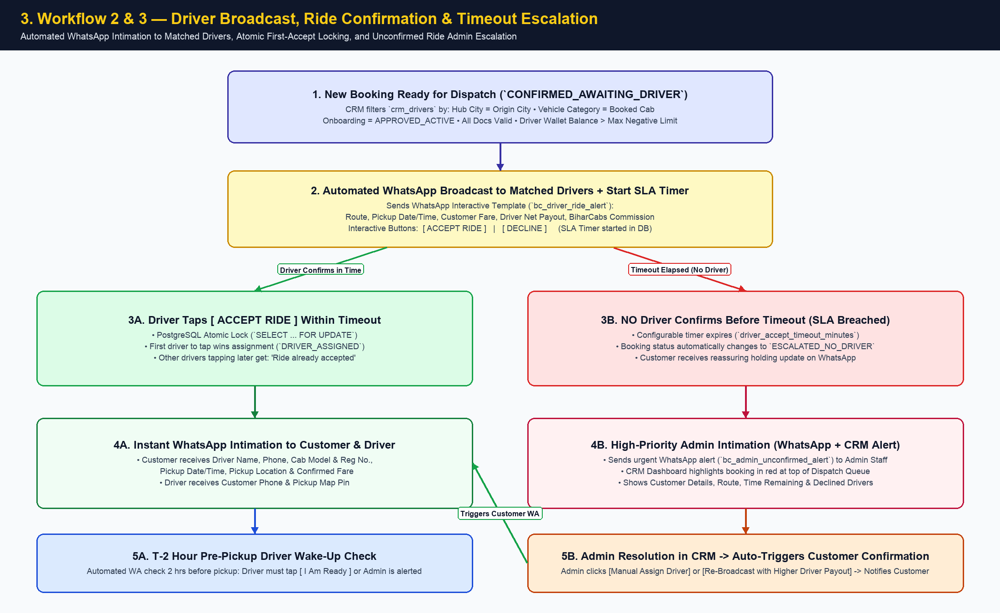
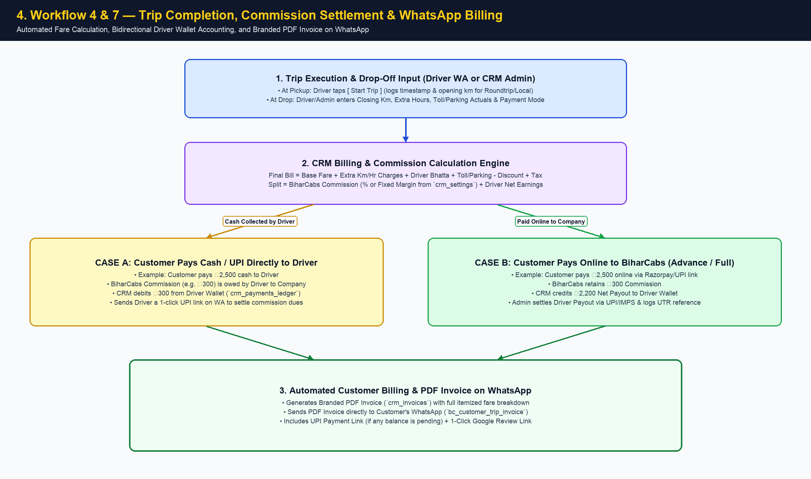
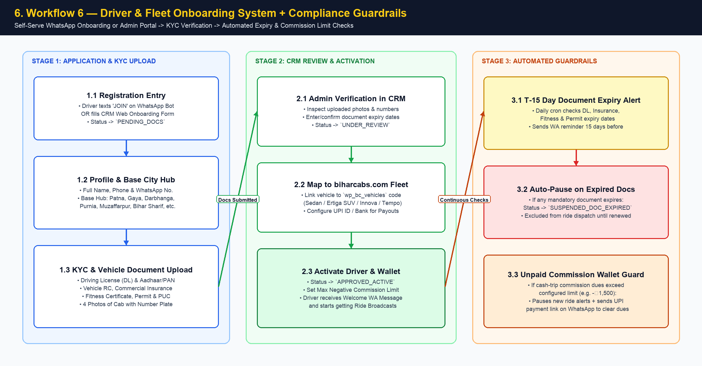
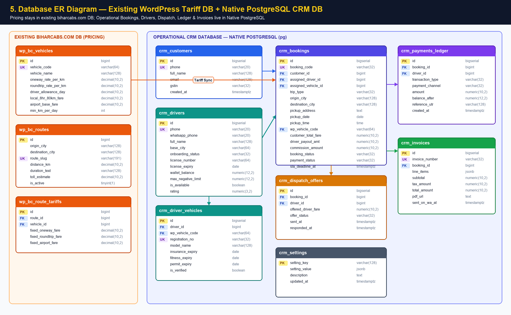

# BiharCabs.com — Automated WhatsApp Booking Workflow & Operational CRM Specification

## Folder Contents & Diagram Index

All diagrams are available inside the [`./diagrams/`](./diagrams/) subfolder in both **High-Resolution PNG** (`.png`) and **Mermaid Source** (`.mmd`) formats:

1. **System Architecture:** [`01_system_architecture.png`](./diagrams/01_system_architecture.png) | [`01_system_architecture.mmd`](./diagrams/01_system_architecture.mmd)
2. **Customer WhatsApp Booking & Pricing Flow:** [`02_customer_booking_workflow.png`](./diagrams/02_customer_booking_workflow.png) | [`02_customer_booking_workflow.mmd`](./diagrams/02_customer_booking_workflow.mmd)
3. **Driver Intimation, Confirmation & Timeout Escalation:** [`03_driver_dispatch_and_escalation.png`](./diagrams/03_driver_dispatch_and_escalation.png) | [`03_driver_dispatch_and_escalation.mmd`](./diagrams/03_driver_dispatch_and_escalation.mmd)
4. **Trip Completion, Commission Settlement & WhatsApp Billing:** [`04_billing_commission_and_settlement.png`](./diagrams/04_billing_commission_and_settlement.png) | [`04_billing_commission_and_settlement.mmd`](./diagrams/04_billing_commission_and_settlement.mmd)
5. **Database Entity-Relationship Diagram (ERD):** [`05_crm_database_erd.png`](./diagrams/05_crm_database_erd.png) | [`05_crm_database_erd.mmd`](./diagrams/05_crm_database_erd.mmd)
6. **Driver & Fleet Onboarding Lifecycle:** [`06_driver_onboarding_lifecycle.png`](./diagrams/06_driver_onboarding_lifecycle.png) | [`06_driver_onboarding_lifecycle.mmd`](./diagrams/06_driver_onboarding_lifecycle.mmd)

---

## 1. Executive Summary & Current-State vs. Target-State

Currently, **BiharCabs.com** captures inquiries on WhatsApp (`+91 7070992170`), where an admin manually negotiates rates, calls drivers to check availability, relays driver details back to the customer, tracks payments/commissions manually, and sends bills manually.

This specification designs an end-to-end **Automated WhatsApp Booking & Dispatch Engine** backed by a dedicated **Operational CRM (Native PostgreSQL)** while reading live vehicle & route tariffs directly from the existing **BiharCabs.com WordPress Database** (`wp_bc_vehicles`, `wp_bc_routes`, `wp_bc_route_tariffs`).

> **Architectural Guardrails Applied:**
> 1. **Zero Hardcoded Values:** All SLA timers, commission rules, advance percentages, tax rates, WhatsApp template IDs, and escalation rules are stored in a dynamic tenant/workspace configuration table (`crm_settings`) in the CRM database.
> 2. **Dual-Database Separation:** Pricing and SEO routes remain in the existing `biharcabs.com` database (exposed via authenticated REST API / read connector), while all operational CRM entities (Bookings, Drivers, Dispatch Logs, Ledger, Invoices) reside in a **native PostgreSQL (`pg`)** database on the host OS.

---

## 2. Gap Analysis: Additional Flows & Features Recommended

Beyond your 7 core requirements, real-world intercity and local cab operations in Bihar encounter specific operational edge cases. Below are the **high-impact additions** we recommend building into the workflow:

| # | Recommended Addition | Why It Is Critical for BiharCabs |
| :--- | :--- | :--- |
| **A** | **Bidirectional Commission & Driver Wallet Ledger** | In 70%+ of trips, customers pay cash/UPI directly to the driver at drop-off. The CRM must track **"Cash Collected by Driver"** and deduct BiharCabs' commission from the driver's ledger, auto-blocking new ride broadcasts if a driver's unpaid commission exceeds a configurable threshold (e.g., ₹1,500). |
| **B** | **T-2 Hour "Driver Wake-Up & Readiness" Check** | Early morning Patna/Darbhanga Airport pickups fail when an assigned driver oversleeps. Automated WhatsApp check-in at T-12h and T-2h requires the driver to tap **`[ I am On Time ]`**. If unconfirmed in 15 mins, Admin is alerted to re-assign before the customer panics. |
| **C** | **Tiered Driver Broadcast + Atomic Locking** | When broadcasting a ride to 10 drivers in Patna, two drivers might tap **`[ Accept Ride ]`** within seconds. PostgreSQL row-level locking (`FOR UPDATE`) ensures only the first driver gets the ride, while tiered waves (Wave 1: Top-rated hub drivers → Wave 2: All hub drivers) maximize quality. |
| **D** | **Admin "Human Takeover" & Custom Route Quote Mode** | If a customer asks for an unlisted village drop, multi-day marriage booking, or negotiates on WhatsApp, the bot flags the conversation as `NEEDS_CUSTOM_QUOTE` so Admin can send a custom price card from the CRM that then resumes the automated driver dispatch flow. |
| **E** | **Configurable Token Advance (UPI Link) vs. Pay-Later** | Outstation one-way cabs suffer high losses if a customer cancels after the cab leaves the garage. The bot can request a configurable token advance (e.g., ₹300–₹500 via Razorpay/UPI link) to auto-confirm, while allowing Admin a 1-click override for trusted/corporate clients. |
| **F** | **Driver Document Expiry Guardrails** | Automatically tracks expiry dates for **Driving License, Vehicle RC, Insurance, Fitness, Permit, and PUC**. Sends WhatsApp renewal reminders 15 days prior and pauses dispatch to vehicles with expired documents. |
| **G** | **Odometer / Extra-Charge Verification for Round Trips & Local** | For Round Trips and Local `8hr/80km` packages, final billing depends on actual closing km, extra hours, and toll/parking. Driver or Admin submits closing km + toll on WhatsApp/CRM to auto-calculate the final invoice before sending it to the customer. |

---

## 3. End-to-End System Architecture

*(Mermaid source: [`./diagrams/01_system_architecture.mmd`](./diagrams/01_system_architecture.mmd))*

---

## 4. Detailed Automated Workflows

### Workflow 1: Customer Booking & Pricing on WhatsApp

*(Mermaid source: [`./diagrams/02_customer_booking_workflow.mmd`](./diagrams/02_customer_booking_workflow.mmd))*

Customers enter via two paths:
1. **Path A (Website-to-WhatsApp):** Customer checks fare on `biharcabs.com` and clicks "Book on WhatsApp" (generated by `BC_Calculator::build_whatsapp_url()`), which sends a structured message containing Route, Trip Type, Date, Vehicle, and Estimated Fare.
2. **Path B (Direct WhatsApp Message):** Customer sends *"Hi"* or *"Patna to Darbhanga cab tomorrow"* directly to the BiharCabs WhatsApp number.

---

### Workflow 2 & 3: Driver Intimation, Confirmation & Timeout Escalation

*(Mermaid source: [`./diagrams/03_driver_dispatch_and_escalation.mmd`](./diagrams/03_driver_dispatch_and_escalation.mmd))*

Once a booking is confirmed (`CONFIRMED_AWAITING_DRIVER`), the **Dispatch Engine** automatically finds and notifies matching active drivers on WhatsApp:
- **Matched Driver Broadcast:** Filters active verified drivers by Origin Hub City, Vehicle Category, Valid Documents, and Wallet Balance above minimum threshold.
- **First-To-Accept Locking:** First driver to tap **`[ Accept Ride ]`** locks the booking in PostgreSQL (`SELECT ... FOR UPDATE`). Both customer and driver immediately receive confirmation on WhatsApp.
- **Timeout Escalation to Admin:** If no driver confirms within the configured SLA (`driver_accept_timeout_minutes`), the booking transitions to `ESCALATED_NO_DRIVER` and immediately alerts Admin on WhatsApp and in the CRM dashboard for 1-click manual assignment or bonus re-broadcast.

---

### Workflow 4 & 7: Trip Completion, Commission Settlement & WhatsApp Billing

*(Mermaid source: [`./diagrams/04_billing_commission_and_settlement.mmd`](./diagrams/04_billing_commission_and_settlement.mmd))*

---

## 5. CRM Modules & Functional Specification

### 5.1 Live Dispatch & Booking Management Board
- **Kanban & Table Views by Status:**
  - `INQUIRY_OPEN` (Customer browsing quotes on WA)
  - `NEEDS_CUSTOM_QUOTE` (Admin negotiation/pricing needed)
  - `AWAITING_ADVANCE` (Waiting for token advance payment)
  - `AWAITING_DRIVER` (Broadcast sent to drivers; live countdown timer shown)
  - `ESCALATED_NO_DRIVER` (Flashing red alert—SLA breached, needs admin intervention)
  - `DRIVER_ASSIGNED` (Confirmed; waiting for pickup date/time)
  - `TRIP_IN_PROGRESS` (Customer onboard)
  - `COMPLETED_UNBILLED` / `COMPLETED_SETTLED`
  - `CANCELLED_BY_CUSTOMER` / `CANCELLED_BY_DRIVER`
- **Admin Override Actions:**
  - **Manual Price Override:** Adjust customer fare, discount, or driver payout before or during broadcast.
  - **1-Click Force Assign / Re-assign Driver:** Assign any registered driver manually or trigger a fresh broadcast wave.
  - **WhatsApp Live Chat Inbox:** View the automated WhatsApp conversation thread and reply manually anytime.

### 5.2 Driver & Fleet Onboarding System

*(Mermaid source: [`./diagrams/06_driver_onboarding_lifecycle.mmd`](./diagrams/06_driver_onboarding_lifecycle.mmd))*

- **Dual Onboarding Channels:**
  1. **Self-Serve WhatsApp Onboarding:** Driver messages *"JOIN"* on WhatsApp → Bot collects Name, City Hub, Vehicle Type, Reg Number, and photos of documents step-by-step.
  2. **CRM Admin / Field Agent Onboarding Portal:** Clean web form for staff to onboard drivers and fleet vendors.
- **Verification & KYC Checklist:**
  - Driver Details: Full Name, Primary Phone, WhatsApp Number, Emergency Contact, Home/Hub City (`Patna`, `Darbhanga`, `Gaya`, `Purnia`, `Muzaffarpur`, `Bihar Sharif`, etc.), Aadhaar & Driving License (DL Number + Expiry Date).
  - Vehicle Details: Linked to `biharcabs.com` vehicle category (`Sedan`, `SUV/Ertiga`, `Innova Crysta`, `Tempo Traveller`), Registration Number (`BR-01-...`), RC Copy, Commercial Insurance Expiry, Fitness Expiry, Permit Expiry, PUC Expiry, 4 Vehicle Photos.
  - Payout & Banking: UPI ID / Bank Account + IFSC for payouts.
- **Approval State Machine:** `PENDING_DOCS` → `UNDER_REVIEW` → `APPROVED_ACTIVE` → `SUSPENDED_DOC_EXPIRED` / `SUSPENDED_UNPAID_DUES`.

### 5.3 Finance, Payment, Driver Payout & Commission Engine
Every booking tracks two financial ledgers simultaneously so accounting is 100% accurate:
1. **Customer Receivable Ledger:**
   - `base_fare` (from `biharcabs.com` DB or custom quote)
   - `extra_km_charge`, `extra_hour_charge`, `driver_allowance`, `toll_parking_actuals`, `night_charge`, `discount_amount`, `tax_gst_amount`
   - `total_customer_payable`
   - `advance_paid_to_company` (via UPI/Razorpay)
   - `collected_by_driver` (Cash/UPI at drop)
   - `final_paid_to_company` (Online settlement)
2. **Driver & Commission Settlement Ledger:**
   - **Commission Rule Engine (Database-Configured):** Supports either **Percentage Commission** (e.g., `12%` of base fare) OR **Fixed Margin Model** (e.g., Customer Fare is `₹2,500`, Fixed Driver Rate is `₹2,150`, BiharCabs Margin is `₹350`).
   - **Net Settlement Formula:**
     $$\text{Driver Net Settlement} = (\text{Total Customer Payable} - \text{Company Commission}) - \text{Cash Collected by Driver}$$
     - If **positive** ($> 0$): BiharCabs owes the driver (e.g., customer paid 100% online to BiharCabs). Recorded as `PAYABLE_TO_DRIVER`.
     - If **negative** ($< 0$): Driver owes commission to BiharCabs (e.g., driver collected 100% cash from customer). Recorded as `RECEIVABLE_FROM_DRIVER` and deducted from Driver's Wallet Balance.

---

## 6. Database Architecture & Integration Design

*(Mermaid source: [`./diagrams/05_crm_database_erd.mmd`](./diagrams/05_crm_database_erd.mmd))*

### 6.1 Integration with Existing `biharcabs.com` Database
The existing WordPress database contains the master pricing tables created by `BC_Database`:
- `wp_bc_vehicles`: Vehicle types, `oneway_rate_per_km`, `roundtrip_rate_per_km`, `driver_allowance_per_day`, `local_8hr_80km_fare`, `airport_base_fare`, `min_km_per_day`.
- `wp_bc_routes`: `origin_city`, `destination_city`, `distance_km`, `duration_text`, `highway_info`, `toll_estimate`.
- `wp_bc_route_tariffs`: Route-specific fixed overrides (`fixed_oneway_fare`, `fixed_roundtrip_fare`, `fixed_airport_fare`).

---

## 7. WhatsApp Message Templates Required (Meta Cloud API)

To automate notifications outside the 24-hour customer service window, the following **WhatsApp Business Utility Templates** will be configured dynamically in `crm_settings`:

1. **`bc_instant_route_quote` (Customer - Interactive):**
   - Displays route distance, travel time, and interactive buttons/list to pick Sedan, SUV (Ertiga), Innova Crysta, or Tempo Traveller with exact prices from `biharcabs.com`.
2. **`bc_driver_ride_alert` (Driver - Interactive Call-to-Action):**
   - *"🚖 New Ride Alert (#{{booking_id}}) | {{origin}} → {{destination}} | Date: {{date}} at {{time}} | Vehicle: {{vehicle}} | Collect from Customer: ₹{{cust_fare}} | Your Net Earnings: ₹{{driver_fare}} (Commission: ₹{{commission}}). Tap below to confirm immediately:"*
   - Buttons: **`[ Accept Ride ]`** | **`[ Decline ]`**
3. **`bc_customer_driver_confirmed` (Customer - Utility):**
   - *"✅ Booking Confirmed (#{{booking_id}})! Your cab for {{origin}} to {{destination}} on {{date}} at {{time}} is scheduled. Driver: {{driver_name}} ({{driver_phone}}) | Cab: {{vehicle_model}} ({{reg_no}}) | Pickup: {{pickup_address}}."*
4. **`bc_admin_unconfirmed_alert` (Admin - High Priority Escalation):**
   - *"⚠️ SLA Alert: Booking #{{booking_id}} ({{origin}} → {{destination}} on {{date}} {{time}}, {{vehicle}}) has NOT been confirmed by any driver after {{timeout}} mins. Customer: {{cust_name}} ({{cust_phone}}). Tap to assign manually in CRM."*
5. **`bc_driver_wakeup_check` (Driver - T-2 Hours Readiness):**
   - *"⏰ Upcoming Pickup Reminder (#{{booking_id}}) in 2 hours at {{time}} from {{pickup_address}}. Please tap below to confirm you are awake and ready."*
   - Button: **`[ I Am Ready & On Time ]`**
6. **`bc_customer_trip_invoice` (Customer - Document + Utility):**
   - Header: **Attached PDF Invoice (`Invoice_BC-1042.pdf`)**
   - Body: *"Thank you for riding with BiharCabs! Here is your official invoice for Trip #{{booking_id}} ({{origin}} → {{destination}}). Total Amount: ₹{{total}} (Balance Due: ₹{{balance}}). Rate your experience: {{review_link}}"*

---

## 8. Phased Implementation Roadmap

- **Phase 1 (Foundation & Pricing Bridge):** Set up native PostgreSQL CRM schema, dynamic settings engine, and live tariff connector to `biharcabs.com` (`wp_bc_vehicles`, `wp_bc_routes`, `wp_bc_route_tariffs`).
- **Phase 2 (Driver Onboarding & CRM Core):** Build Driver & Vehicle Onboarding (Web + WhatsApp flow), KYC verification dashboard, and Booking Management board.
- **Phase 3 (WhatsApp Booking Bot & Automated Driver Dispatch):** Implement customer quote/booking state machine, driver broadcast waves, atomic ride locking, and SLA timeout escalation to Admin.
- **Phase 4 (Billing, Commission Ledger & PDF Invoices):** Implement trip completion flow, bidirectional commission wallet ledger, automated PDF invoice generation, and WhatsApp billing delivery.

