# BiharCabs CRM: Flow Diagrams

These diagrams show what the code does as of `main` @ 5e692db (2026-11-20), not the intended design. Each section names the source files it was drawn from. Figures in brackets (e.g. **[3%]**) are the current values in `crm_settings`; they are configurable, not fixed.

1. [Business flow](#1-business-flow)
2. [Business rules](#2-business-rules)
3. [Tax calculations](#3-tax-calculations)
4. [WhatsApp + CRM: end-to-end ride cycle](#4-whatsapp--crm-end-to-end-ride-cycle)

---

## 1. Business flow

How a ride moves from enquiry to money and tax documents. Sources: `whatsapp-bot.ts`, `advance-payments.ts`, `dispatch-engine.ts`, `billing.ts`, `gst-delivery.ts`.

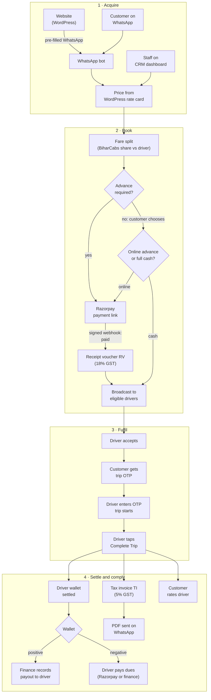

**Who earns what:** the customer pays the fare to BiharCabs (advance) and the driver (cash). BiharCabs keeps its share, and the driver keeps the rest. See [section 3](#3-tax-calculations).

---

## 2. Business rules

### 2a. Booking lifecycle

Every `booking_status` and what moves a booking between them. Sources: `whatsapp-bot.ts`, `advance-payments.ts`, `dispatch-engine.ts`, `trip-otp.ts`, `billing.ts`, `cancellations.ts`, `advance-rules.ts`.

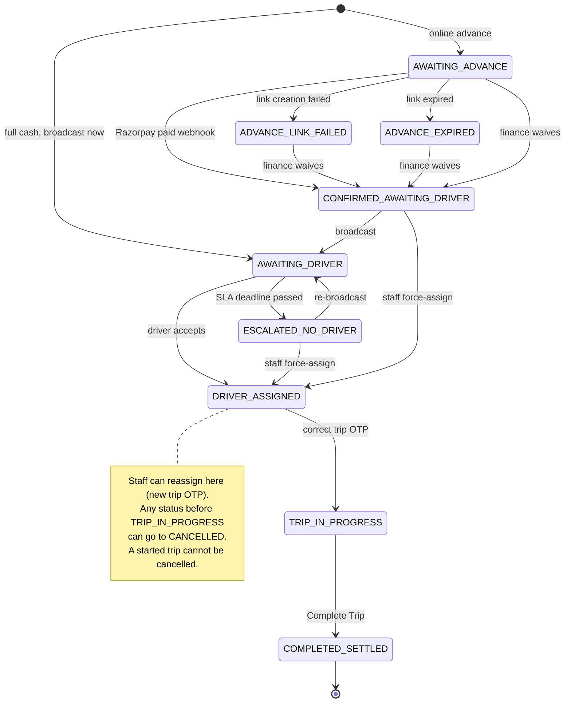

`CANCELLED` is left off the chart to keep it readable. It can be reached from `AWAITING_ADVANCE`, `ADVANCE_LINK_FAILED`, `ADVANCE_EXPIRED`, `CONFIRMED_AWAITING_DRIVER`, `AWAITING_DRIVER`, `ESCALATED_NO_DRIVER` and `DRIVER_ASSIGNED`.

### 2b. Is the advance required? How much?

Source: `isAdvanceRequired` in `advance-payments.ts`, `splitFare` in `fare-split.ts`.

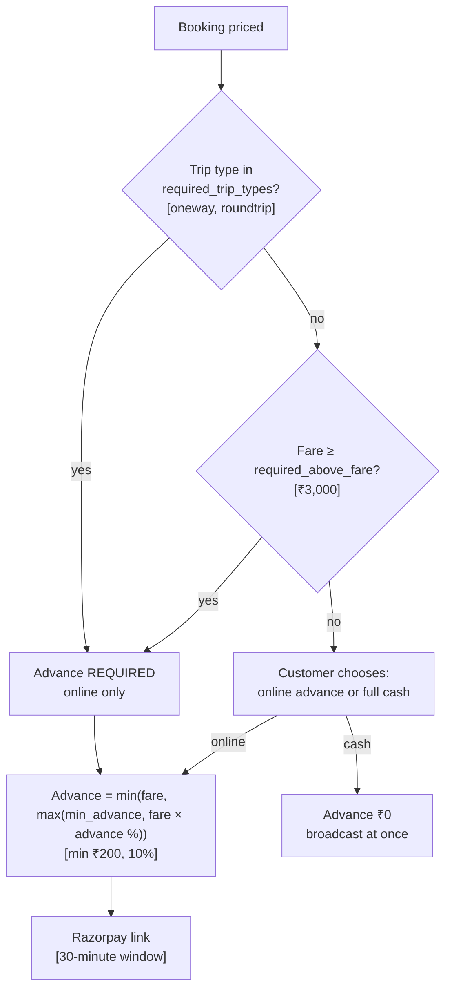

The server decides: a ride that needs the advance can't be switched to cash, whatever the client sends. `advance_paid` holds only money confirmed by a signed Razorpay webhook.

### 2c. Which drivers can get a ride?

The same rules apply at broadcast, at acceptance (re-checked with the driver's row locked) and at staff force-assign. Source: `eligibilityRows` in `dispatch-engine.ts`.

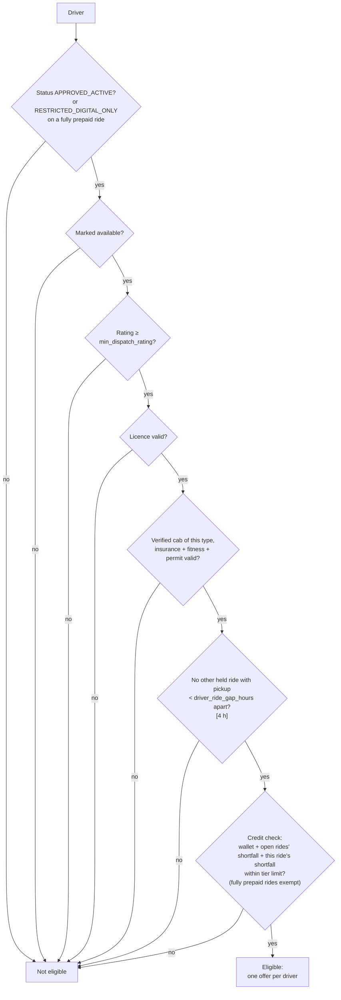

### 2d. Driver credit, restriction and incentives

Sources: `driver-dues.ts`, `billing.ts`, `settings` → `revenue_protection_policy`.

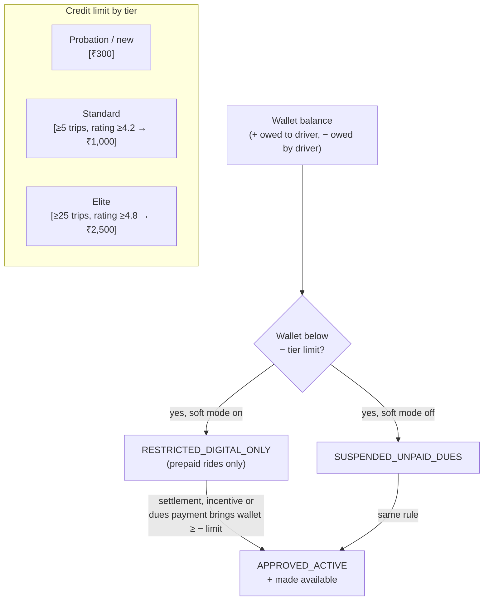

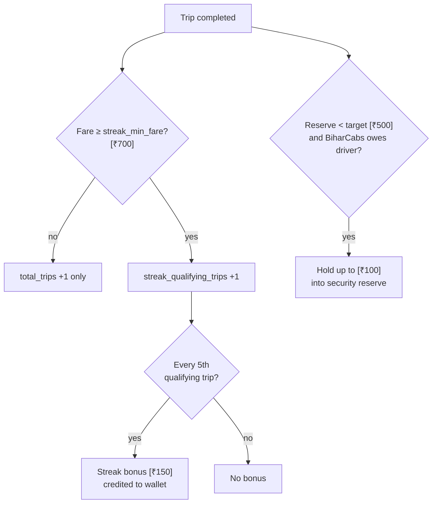

### 2e. Cancellation and refund

Sources: `cancellations.ts`, `refunds.ts`, `cancellation-charges.ts`.

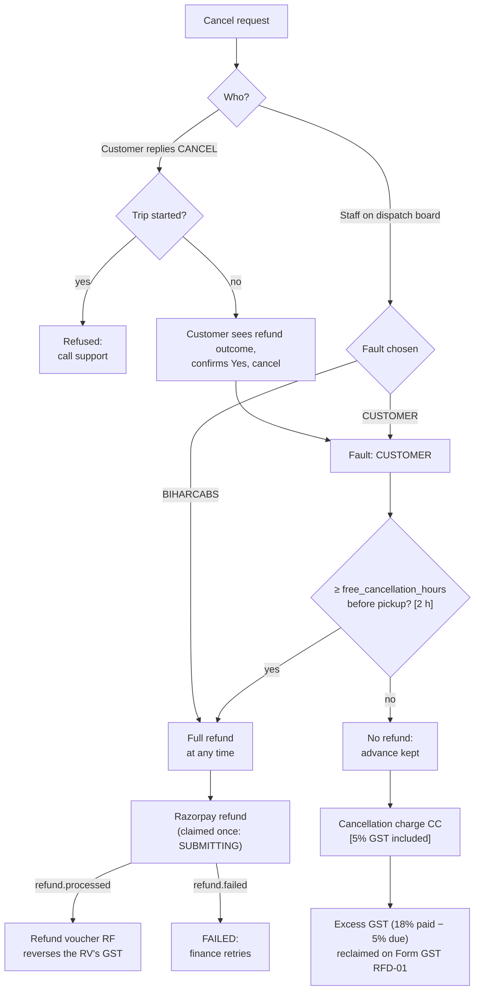

Every cancellation closes any unpaid Razorpay link first. It also closes pending driver offers, clears the trip OTP, and tells the customer and any assigned driver.

---

## 3. Tax calculations

### 3a. Fare split at booking

Source: `splitFare` in `fare-split.ts`, used by every booking and by return-trip discounts. GST treatment per BiharCabs' CA: BiharCabs is liable for the ride GST under CGST Sec 9(5), and the driver bears it.

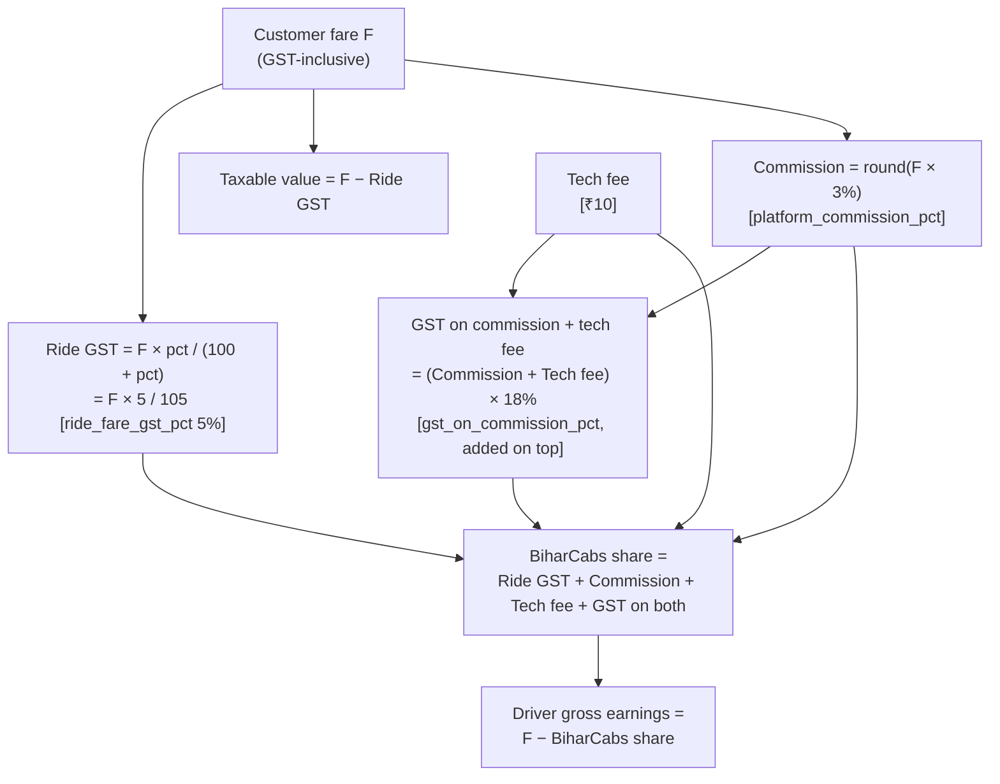

### 3b. Worked example: ₹2,500 one-way ride, intra-state (Bihar)

These figures were produced by running the real `splitFare` and `splitGst` code with the current settings.

> **GST included in a price:** `GST = amount × pct / (100 + pct)` (`gstIncluded` in `fare-split.ts`).
> The fare already contains the GST: 100 parts ride value plus *pct* parts GST. At 5%, GST is 5 of every 105 rupees, so 2,500 × 5 / 105 = ₹119.05. Taking a plain 5% of ₹2,500 (₹125) would charge GST on the GST.

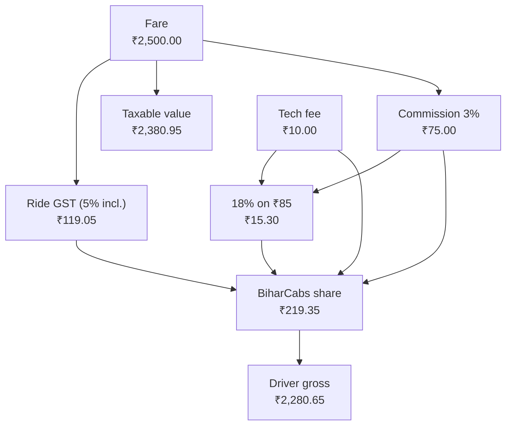

| Step | Amount |
|---|---|
| Advance (oneway → required): max(₹200, 10% of ₹2,500) | ₹250.00 |
| GST in the advance at 18% (receipt voucher RV): amount × pct / (100 + pct) = 250 × 18 / (100 + 18) | ₹38.14 → CGST ₹19.07 + SGST ₹19.07 |
| Cash the driver collects at drop: 2,500 − 250 | ₹2,250.00 |
| Driver net for this trip: gross 2,280.65 − cash 2,250 | **+₹30.65 owed to driver** |
| Security reserve hold (if reserve < ₹500): min(₹100, deficit, ₹30.65) | up to ₹30.65 |
| Tax invoice TI: GST on the fare, amount × pct / (100 + pct) = 2,500 × 5 / (100 + 5) | ₹119.05 → CGST ₹59.53 + SGST ₹59.52 |

### 3c. Settlement and tax documents

Sources: `completeTripAndSettle` in `billing.ts`, `place-of-supply.ts`, `gst-documents.ts`.

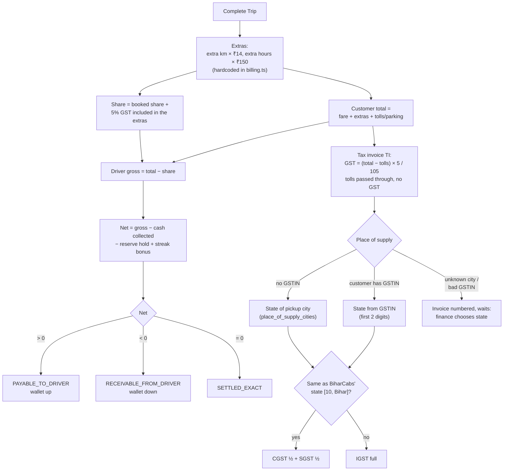

**Note:** the rates for extra km (₹14) and extra hours (₹150) are written into the code (`billing.ts:82`, `billing.ts:86`), not read from settings. Today they're only used when settlement receives closing km or extra hours. The WhatsApp **Complete Trip** button sends neither, so a bot-completed trip never charges extras.

### 3d. GST documents and series

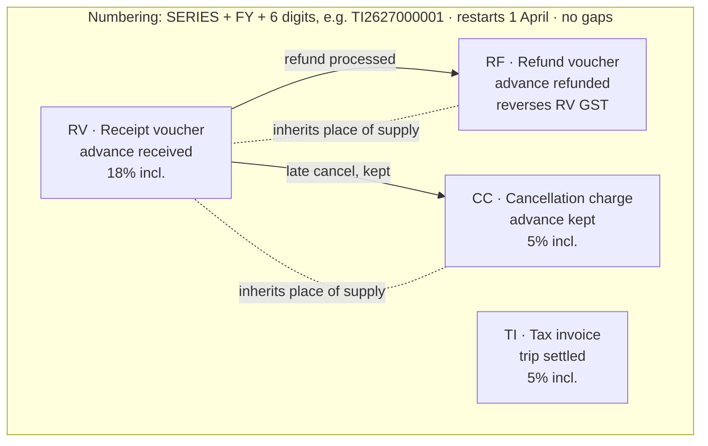

---

## 4. WhatsApp + CRM: end-to-end ride cycle

A WhatsApp booking with an online advance, through completion and delivery of the GST document. Sources: `whatsapp/webhook/route.ts`, `whatsapp-bot.ts`, `advance-payments.ts`, `dispatch-engine.ts`, `trip-otp.ts`, `billing.ts`, `cron-service.ts`, `gst-delivery.ts`, `wa-notify.ts`.

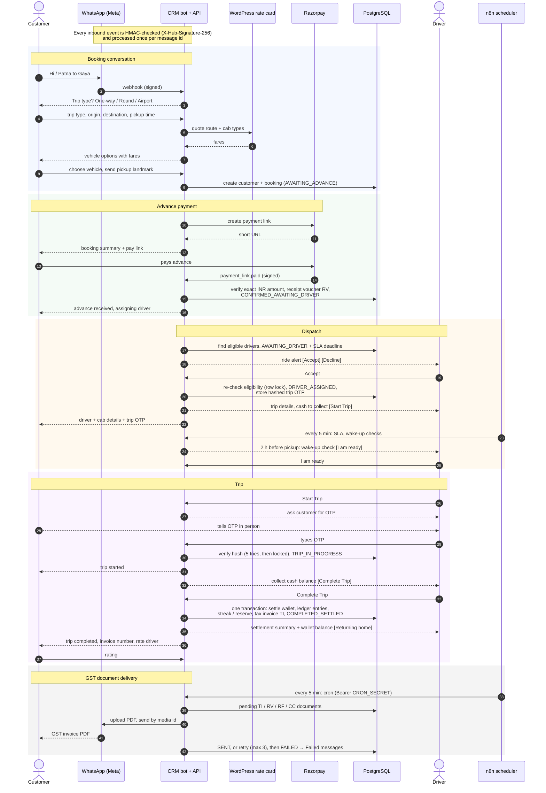

**Outside the 24-hour window:** every message BiharCabs starts goes through `notify()`. Outside the 24-hour window it sends the approved template instead of free text. A template button tap is mapped back to its booking (`crm_wa_template_sends`). Any failed send is logged to `crm_notification_failures` and summarised to admins.

### 4b. Driver-side states inside WhatsApp

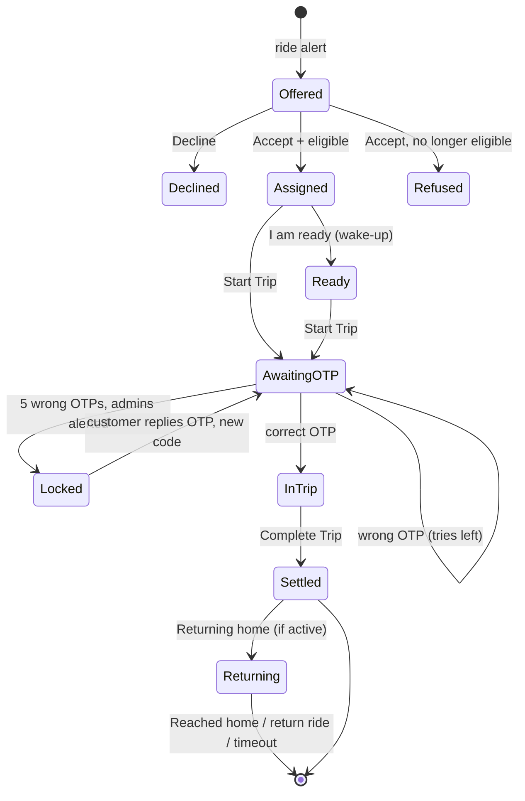
